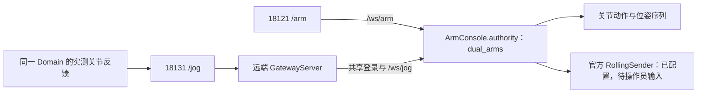

# 18121 与 18131 的统一双臂控制权

2026-11-07 已在工控机部署并验证。主操作台为 `http://192.168.100.40:18121/arm`，末端页为 `http://192.168.100.40:18131/jog`。18121 顶栏的“机械臂末端控制”在新标签页打开同一主机的 18131。两页共享登录，控制权按连接互斥；从链接跳转不会自动转移控制权。

当前 18131 已启用真机 Mink → Rolling 键盘入口，18121 已启用 `--jog-motion-enabled`。两者连接 `bench_dual_arm_head_wrist_force`、Domain 77，显示完整模型与反馈 FK 轨迹。重启后保持未使能、未接管；本次没有使能、模式切换或实机运动。

## 唯一权限入口



18131 不建立第二套双臂租约。代理核对协议、Domain、运行 URDF 原文 SHA-256 和受控关节集合；不一致或权限连接过期时拒绝获取权限。一个登录的多个标签页也不能同时持有双臂。

两端口共享 Cookie。在 18121 重新登录后，18131 会关闭旧会话的连接，使用新 Cookie 重新认证，避免反复要求输入令牌。首次登录也会先退出旧的认证连接，再关闭登录框；等待输入令牌期间暂停自动重试。会话重建会退出键盘接管，不自动获取控制权，不重放运动或其他写入请求，操作员需重新获取控制权并开启键盘接管。只有重新认证确认会话失效时，才再次显示登录框。

关节动作、序列及作用域的使能/复位经过同一资源。运动中松开权限或断线先进入停车状态，全部已提交请求获得明确终态，且终态之后的实测静止窗口齐全，才允许交接。结果不明时保持占用。空闲持有者断开可直接归还。租约为 3 秒，WebSocket 状态循环续期。

启动先处于 `unverified`，依据公开反馈完成对账：

- Rolling active：当前五字段状态必须为 HOLDING，状态新鲜，且 JTC inactive；实测位置在配置的采样窗口内静止。
- JTC active：没有活动 Action，目标速度为零；有实际速度反馈时检查 JTC 的 `constraints.stopped_velocity_tolerance`，仅位置反馈时检查配置的实测静止窗口。首次未收到 Action 状态时，只能由已观测的 JTC inactive 状态建立无活动目标证据；不能将状态缺失当作空闲。
- 两种运动控制器都明确 inactive：仍要求实测位置静止窗口。缺失、unconfigured 或不确定状态不能替代 inactive。

位置窗口使用 `EnableManagerController` 的 `motion_joints`、`mode_switch_stable_velocity_thresholds`、`mode_switch_stable_interval_count`。没有默认硬件阈值；采样重复、时间倒退、反馈中断及位置缺失会使证据失效。

## 按执行入口自动选模

18121 的关节动作、到位和序列选择 JTC；18131 的 `begin_motion` 选择 Rolling。两种控制器可一起加载，执行时只能有一种激活。获取页面权限或打开页面不会切换模式，也不自动使能。

持有者发起有效运动请求后，在同一权限代次内预留执行资源，验证已使能、反馈新鲜和停稳，通过公开 `/rt/arms/set_control_mode` 选择模式。模式已匹配时不重复调用。服务成功后还须确认控制器互斥状态与切换后的完整停稳窗口，才能发送动作或接受末端窗口。

切换期间拒绝其他运动请求，继续处理停止、释放和断线；取消后原请求不能迟到发布。明确拒绝不发轨迹；响应超时、实际模式不符或结果不明时保留占用，不能自动交接。服务响应截止为 5 秒，控制器查询同为 5 秒，切换后反馈观察为 2 秒；这些只约束通信等待，不改变硬件阈值。

本地模式选择、取消竞态及公开消息构造测试通过。远端已配置末端发布；真实控制器自动切换和末端运动验收尚未执行。

## 运行与启动文件

远端隔离发行目录为 `/home/ar/gripper-jog/releases/shared-authority-20261107`：

- `script/start_primary.sh`：只启动 18121 网页。
- `script/start_gateway.sh`：使用独立 `.venv` 启动 18131 Mink 键盘代理，反馈由主操作台提供。
- `primary.log`、`gateway.log`：网页日志；`gateway-evidence*/`：只读模型与运行身份记录。
- `manifest.json`：本次发行源码指纹。
- `keyboard-preflight.json`、`keyboard-deployment.json`：当前 artifact 离线窗口检查及网页部署记录；`keyboard-startup-backup-*/` 保留本次修改前的启动脚本。

脚本需要当前实时栈已经运行。不要在对应端口已有服务时重复启动。控制栈为 `/home/ar/rt-control-arch-20261106`，作用域仍为 `bench_dual_arm_head`，当前实际 artifact 为 `artifacts/bench_dual_arm_head_wrist_force`，Domain 77；这些是本次部署事实，不是其他台套的默认值。原 Domain 78 的控制进程已由另一处调试替换，本次仅重启两个网页，保留新实时进程。网页令牌沿用受保护的现场令牌文件。

本地集成工作树为 `/home/zlz/Desktop/ing_obj/frame/robot_driver_jog_current`，基线 `cbf4116`，公共接口 pin `aa82a77`，本文件保留 2026-11-07 的部署记录；2026-11-09 组件 v0.2.0 已冻结，配套驱动提交见 `integration/release.json`。补丁及指纹可复核：

```bash
.venv/bin/python -B tools/check_shared_authority.py
```

## 验证边界

远端真实两端口已验证：同一登录双向互斥、释放后的双向交接、空闲断线归还、Domain/模型一致、实时反馈有效。浏览器整机渲染、跳转及共享登录通过，未发现页面脚本错误；测试结束权限全部归还，没有发送运动指令。

登录修复回归：13 项 JavaScript 测试、10 项网关与 HTTP 测试通过。本地浏览器验证错误令牌、首次登录、三次跨页会话更新、失效会话暂停重试、重新登录与刷新恢复；远端浏览器验证首次登录、18121 更新登录后的自动重连及整机渲染。仅更新远端 `web/gateway.mjs` 和 `web/jog.mjs`，未重启网页或实时控制进程，未获取控制权、使能或发送运动。

该锁约束本主操作台的入口，不能仲裁独立 ROS 发布者。已实现的可选键盘运动链、启用方式与尚待完成的实机核验见 [真机键盘链](REAL-KEYBOARD.md)。
