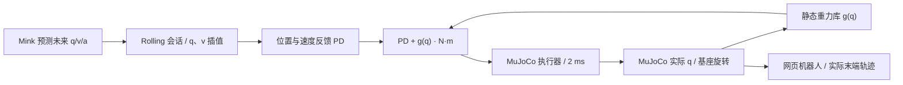

# 静态重力补偿接入

2026-11-03 按用户要求取消默认调用：默认 `--gravity-mode off`，不加载、构建或调用静态重力库，也不使用 MuJoCo bias 前馈。两种 Mink 后端及一键脚本均继承此默认值；状态显示 `mode=off`、`enabled=false`、前馈力矩全零。物理重力仍存在，关闭补偿后反馈控制会有持重偏差。本变更不修改真机控制器或驱动配置。

以下记录保留的可选适配及先前验收，只有显式使用 `--gravity-mode static` 才启用外部 `sim/Dynamic_Parameter_Identification/static_gravity`。原 `--backend mink` 也使用同一执行端及预演公式。旧 `--backend mock` 不执行物理补偿。



## 输入与执行

- 力矩为关节输出端 N·m，角度为当前 URDF 定义的实际 rad，正方向沿对应 joint axis。
- 静态库原生顺序为左 J1～J7、右 J1～J7；运行后端为右、左，使用 `Gravity(names=backend.names)` 显式映射。不能按数组下标直接拼接左右臂。
- 每个 2 ms 物理步取实际 `qpos`，提供实际 J1 父帧到世界的旋转和模型世界重力。J1 安装旋转与固定工具质量已包含在导出参数中，不再叠加零位、安装角或工具负载。
- 双臂同时补偿，覆盖移动、减速和静止保持；切换控制臂不切换补偿轴。正常松键或停止点动后仍补偿重力，防止仿真手臂下垂。
- 未来 Rolling 点仍只有 q/v；重力不取未来目标角，不随网页 200 ms 状态轮询计算，不加入 Rolling 公共 IDL。

当前 MuJoCo 的关节位置执行器使用 gear=1，原后端已校验此语义：

```text
tau_cmd = kp * (q_desired - q_actual)
        + kv * (v_desired - v_actual)
        + g(q_actual)
ctrl    = q_desired + (kv * v_desired + g(q_actual)) / kp
```

`GravityBackend.command()` 是唯一合成入口，实际执行和原 Mink 模式的碰撞预演共用它。static 模式完全替换原来的 `qfrc_bias` 前馈；后者含重力和科氏/离心项，不能再相加。总输出仍受 MuJoCo 既有 actuator force range 限制。当前库只算静态重力，不补偿摩擦和运动惯性。

## 模型与缓存

源静态库现存导出参数对应历史 URDF，和当前 real2sim 标定双臂不一致。集成不会改写源库的参数、快照或二进制，也不会把旧库直接用于当前模型。

首次启动将必要的源码和导出器复制到本项目 `.runtime/static-gravity/` 临时构建目录，显式使用 `--real2sim` 下的 `urdf/robot.urdf` 导出，再用 CMake 编译。完整包生成后原子重命名到按算法源码和 URDF 字节哈希索引的缓存。正常运行不编译、不读取文件、不启动子进程；Python→C ABI 调用在本机控制线程中完成，不构成硬实时保证。

复用缓存时校验源文件、URDF、二进制哈希；库自身核对 URDF 快照、参数签名和编译签名。初始化还在独立 `MjData` 上用初始姿态、零姿态和六组固定种子的角度对照 MuJoCo `qvel=0` 时的重力，允许绝对差 1e-7 N·m，校验不改变实际仿真姿态或时钟。模型不一致、陈旧库、源码缺失和构建失败均拒绝启动，不静默切换算法。缓存错误消息给出具体路径，核对后可删除该目录并重新启动。

```bash
# 默认关闭重力补偿，不依赖外部静态库。
script/start_sim.sh

# 显式开启静态算法；首次构建需要 CMake、C/C++ 编译器。
script/start.sh --gravity-mode static --gravity-source /path/Dynamic_Parameter_Identification/static_gravity

# 仿真对照模式，各模式只选一个，不叠加。
script/start_sim.sh --gravity-mode mujoco
script/start_sim.sh --gravity-mode off
```

不加载库时只有显式的 `mujoco` 模式保留原 bias 前馈；`off` 模式只运行反馈控制。参数在启动时确定，没有运动中的重力开关。

## 状态与失效

`GET /api/jog/state?client=...` 的 `gravity_compensation` 包含 `mode`、`enabled`、`joint_names`、`torques_nm`、`period_s`、`evaluations`、`last_compute_s`、`fault`、URDF 哈希、参数签名和启动对照最大差。`torques_nm` 为上次实际物理步使用的静态前馈值，非总电机力矩。碰撞预演不会覆盖这些实际输出记录。首次物理步前记录为零。

计算抛异常、返回维度错误或非有限力矩时，清掉旧前馈命令，停止推进物理，引入锁定故障；上层退出键盘接管、撤销反馈就绪，并继续处理 Rolling 的 STOP/FINALIZE。不会自动重试计算恢复运动，需重启本地仿真。软件停止不等于断电或实体急停。

## 实机控制器边界

`robot_driver/src/rt_control/ctrl_gravity_feedforward` 是另一个 RT-Control 控制器草稿，使用权威模型和 KDL 计算重力，拟与 Rolling 的 position 命令并行写入 additive effort。其 `gravity_feedforward:=true` 当前仍按 BQ-155 拒绝启动，本次没有修改或绕过该准入。

当前集成仅在本地 MuJoCo 合成 N·m，不向真实驱动发送 effort/current。实机必须完成逐轴符号/力矩标度/减速比换算、CSP 叠加前馈的 PDO 映射、可持续力矩和变化率限制、实测反馈时效与健康状态、控制器启停清零等接入，才能由 RT 执行端启用补偿。不能将这里位置执行器的 `tau/kp` 等效 ctrl 公式用于真实电机接口。

## 本次验证

2026-11-03，当前模型 URDF SHA-256 为 `49fd20da87f7dd50996eac1997bddb25f169d95c8c39060b1e1aecde4fae8e93`，参数签名为 `92ece1b4c6ee62717c33a3236a532e2068fc7a5e11c090cae3ff26ed19cf8de3`。启动对照最大差约 7.1e-14 N·m。

`tests/test_gravity.py` 覆盖 100 组随机姿态与任意重力/旋转、实际角度与轴序、静态项与原 bias 不重复、双臂 3 秒保持、显式对照模式、预演隔离、计算失效锁定与 Rolling 清理、场景惯性不一致拒绝、缺源码拒绝，以及独立构建保留原库/陈旧缓存拒绝。既有 Mink/Rolling 运动测试也在默认 static 模式下执行，包含双臂六方向、速度、松键、超时和故障清理。测试结果不构成实机力矩或电流验证。

本次完整 Python 回归为 **364 passed, 1 skipped**（118 秒）；跳过项为缺少 ROS 公共生成类型的接口测试。前端输入模块 **10 项通过**，JavaScript 与启动脚本语法检查通过。网页 + 同进程 MuJoCo 原生窗口联调中，长按 2.2 秒实际前移约 10.54 mm，批次达 27；改速保持同一会话并替换未来尾段，松键后确认 FINALIZE，静态补偿继续更新，页面脚本错误为零。测试结束后控制权和键盘接管均已释放。

独立本机测量：双臂保持 3,000 个物理步（6 秒），最大关节误差约 8.9e-17 rad；该次补偿计算中位数约 20.4 μs、99 分位约 63.9 μs。这是本机仿真测量，不是 RT 域或目标硬件的执行周期保证。
