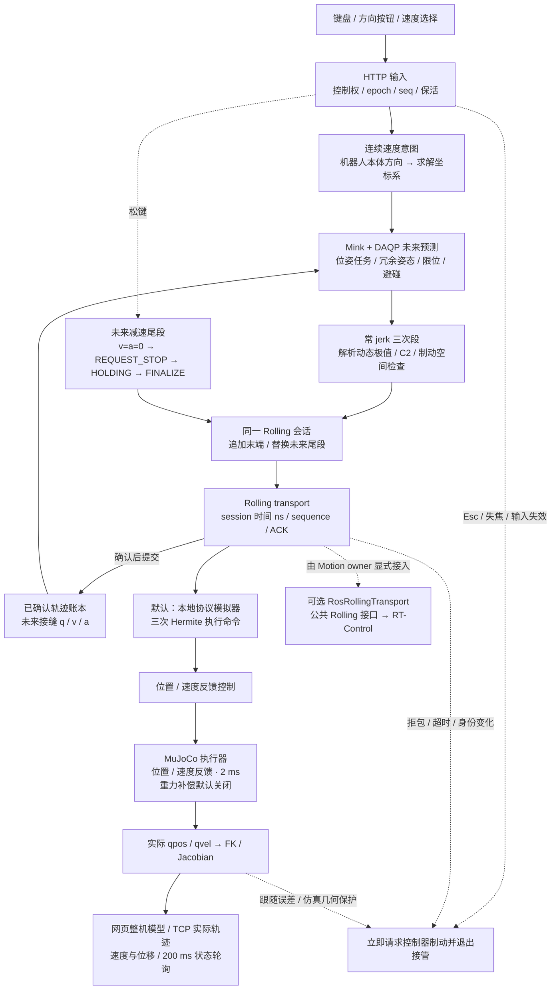

# 当前 Mink → Rolling 控制链路

默认 `mink-rolling` 模式在一个会话内持续补充未来轨迹。默认执行端是本地 Rolling 协议模拟器和 MuJoCo，不调用 JTC/FJT，不启动 ROS/DDS，尚未连接真实电机。



## 时间与连续性

- 按下发一次 `/velocity`，每 100 ms 独立 `/heartbeat`，400 ms 输入失效时退出接管。系统重复按键不会反复启动。
- open 后先发布合法静止窗口，ACK 后从未来 knot 替换为移动尾段。长按期间持续续流，不使用固定 5 mm 终点，不反复 open/finalize。
- 协商决定窗口与轨迹点间隔。本地默认约 540 ms 前瞻、20 ms knot、67 ms 更新一次；改速或换向及时替换未来尾段，不等待整段前瞻执行结束。轨迹时间由 controller session 提供，不能用浏览器或墙钟替代。
- 追加或替换从已确认的 q/v/a 开始，每次最多一个未确认批次。保留前缀、接缝和新点共同计入容量，账本长度有界。

每段设末端加速度为 `a1`，间隔为 `h`：

```text
j  = (a1-a0)/h
q1 = q0 + v0*h + (a0/3+a1/6)*h²
v1 = v0 + (a0+a1)*h/2
```

控制器用 q/v 重建同一三次多项式，位置、速度和加速度跨接缝连续，jerk 绝对值受限。正常松键先减至 v=a=0 再关闭；异常情况下使用控制器制动，其连续性与 jerk 不由本客户端规划保证。

## 模型反馈与范围

Mink 使用独立 Configuration 预测未来，另一臂关节保持会话 hold。轨迹经模拟器插值后驱动物理执行器，网页显示实际 qpos/qvel 计算出的整机与 TCP，正常控制不直接改实际 qpos。未来轨迹的 TCP 速度与几何仍是采样验证，不能等同实机避碰或硬实时验收。

源码入口：`mink_rolling.py` 负责预测、动态约束、减速尾段及物理反馈；`rolling_stream.py` 负责未来窗口；`rolling.py` 负责公共会话生命周期；`rolling_ros.py` 提供可选 ROS 传输。

按用户要求，默认 `gravity-mode=off`，不调用静态重力库或 MuJoCo bias 前馈。`gravity.py` 的静态库适配仅在显式选择 `--gravity-mode static` 时启用，原 bias 仅在 `--gravity-mode mujoco` 时启用。实际执行与碰撞预演共用相同模式。详见 [可选重力补偿与停用记录](GRAVITY.md)。

完整接口与限制见 [Mink → Rolling](MINK-ROLLING.md)。原 `--backend mink` 直接仿真链路仍保留，见 [直接仿真说明](MINK.md)。
